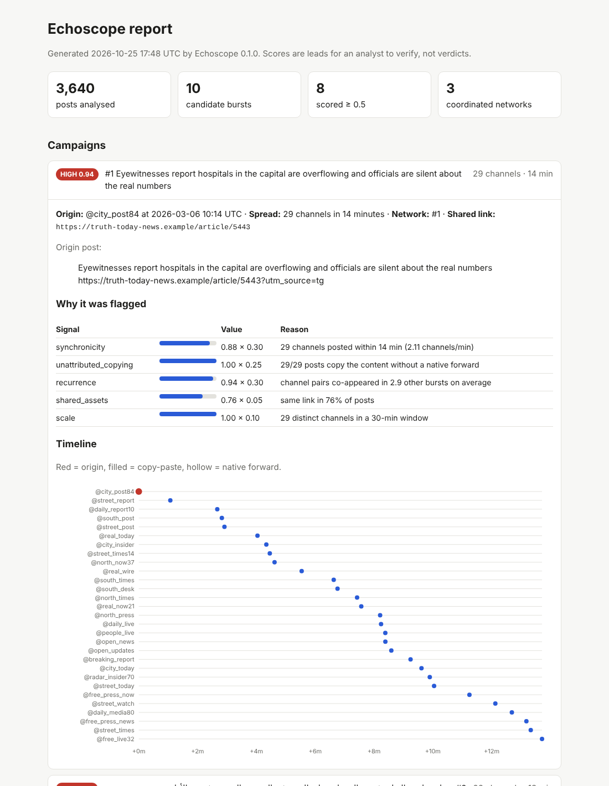
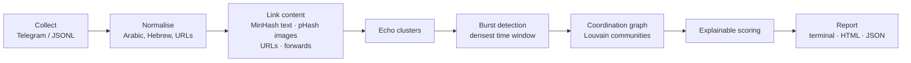

# Echoscope

**Detect coordinated influence campaigns across public messaging channels.**

Echoscope finds networks of channels that push the same message at the same time to make
it look organic. It collects public posts (Telegram first), finds near-identical text,
images and links even after they've been edited, maps who posted first and who amplified,
and reports each campaign with an explainable confidence score.

[](https://github.com/harelhz/echoscope/actions/workflows/ci.yml)




## The problem

During wars and elections, influence operators run dozens or hundreds of channels that look
independent. When they push a narrative, the same message appears across all of them within
minutes, slightly reworded so it doesn't look copied. Real news spreads differently: over
hours, in different words, usually with native forwards that credit the source.

Spotting this by hand means reading thousands of posts across many channels and languages.
Echoscope does the first pass and answers one question: **is this spreading organically, or
is someone running a campaign?**

## Example output

```
⚠ Campaign #1   score 0.94 (HIGH)
Narrative: Eyewitnesses report hospitals in the capital are overflowing...
Origin:    @city_post84 at 2026-03-06 10:14 UTC
Spread:    29 channels in 14 minutes
Network:   #1 (30 channels)
Shared link: https://truth-today-news.example/article/5443

 Signal                Value  Weight  Why
 synchronicity         0.88   0.30    29 channels posted within 14 min (2.11 channels/min)
 unattributed_copying  1.00   0.25    29/29 posts copy the content without a native forward
 recurrence            0.94   0.30    channel pairs co-appeared in 2.9 other bursts on average
 shared_assets         0.76   0.05    same link in 76% of posts
 scale                 1.00   0.10    29 distinct channels in a 30-min window
```

Every score breaks down into named signals with a plain-language reason, so an analyst can
check *why* something was flagged instead of trusting a black box.

## How it works



1. **Normalise.** Operators make small edits so copies don't match: Arabic letter variants
   (أ/ا), diacritics, Hebrew niqqud, emojis, hashtags, tracking parameters. These are stripped
   before comparison.
2. **Link similar content.** Text is compared with **MinHash + LSH** over character
   shingles, which is language-agnostic and close to linear time. Images are compared with
   **perceptual hashes** and a pigeonhole-banding index, so cropped or recompressed copies
   still match. Shared links and native forwards link posts too, while channel footer links
   are detected and ignored.
3. **Find bursts.** Each cluster of similar posts is split into events, and a sliding window
   finds the densest burst of distinct channels.
4. **Map the network.** Channels that keep appearing in the same bursts are connected.
   Louvain community detection groups them into likely operator networks.
5. **Score.** Five weighted signals: synchronicity, unattributed copying, recurrence, shared
   assets and scale. See [docs/DESIGN.md](docs/DESIGN.md) for the reasoning behind each.

## Quickstart

```bash
git clone https://github.com/harelhz/echoscope && cd echoscope
pip install -e .

echoscope demo          # synthetic week with planted campaigns -> echoscope-demo.html
```

The demo builds a simulated week of activity (3,600+ posts from 122 fictional channels) with
two planted sockpuppet networks, plus organic look-alikes designed to trick the detector:
news stories covered by many channels, a viral post forwarded widely, and an official
statement copy-pasted by aggregators. Then it scores itself against the known ground truth.

## Benchmark

On the synthetic scenario (10 random seeds, threshold 0.5):

| Metric | Result |
|---|---|
| Campaign precision | 100% |
| Campaign recall | 100% (8/8 planted campaigns) |
| Network recovery | 83 to 100% of each network's channels grouped together (usually 100%) |
| Organic look-alikes | all ranked below every planted campaign |
| Runtime | about 1 s for 3,600 posts on a laptop |

Synthetic data proves the pipeline works as designed, not that it works in the wild.
Evaluation on real, publicly documented takedown datasets is on the roadmap.

## Collecting from Telegram

```bash
pip install -e ".[telegram,media]"
export TELEGRAM_API_ID=...    # from https://my.telegram.org
export TELEGRAM_API_HASH=...

echoscope collect telegram examples/channels.example.txt --since 7d
echoscope detect --since 7d --html report.html --json report.json
```

Collection uses the official API, reads **public channels only**, and is incremental:
re-running continues where it left off. With the `media` extra, photo thumbnails are
perceptual-hashed so re-posted images are matched. The images themselves aren't stored.

## Bring your own data

Any platform works if you convert it to JSON Lines, one post per line:

```json
{"platform": "x", "channel": "some_account", "message_id": "123",
 "timestamp": "2026-03-01T10:00:00Z", "text": "...", "urls": ["https://..."],
 "media_hashes": ["c3d4e5f6a7b8c9d0"], "forward_of": null}
```

```bash
echoscope import posts.jsonl
echoscope detect --html report.html
```

## Commands

| Command | Purpose |
|---|---|
| `echoscope demo` | Run on synthetic data and print benchmark scores |
| `echoscope collect telegram FILE` | Collect public channels listed in FILE |
| `echoscope import FILE.jsonl` / `export FILE.jsonl` | Move data in and out |
| `echoscope detect` | Find campaigns (`--since`, `--window`, `--min-channels`, `--html`, `--json`) |
| `echoscope stats` | Show what's in the database |

## Limitations

- **Copy-paste isn't always malicious.** News aggregators copying an official statement
  look synchronised. Recurrence helps separate them, but scores are leads for a human to
  verify, never verdicts.
- **Paraphrased campaigns** (where each copy is rewritten, for example by an LLM) evade
  shingle-based matching. Multilingual embeddings are the planned fix.
- **Cross-language campaigns** (the same narrative in Arabic and Hebrew) aren't linked yet.
- Single-linkage clustering can chain unrelated content in very large datasets; burst
  detection limits the damage, but it isn't eliminated.

## Roadmap

- [ ] Multilingual sentence embeddings for paraphrase and cross-language matching
- [ ] Video keyframe hashing
- [ ] Enrichment: domain registration age (RDAP), certificate transparency, channel creation
      dates and subscriber growth
- [ ] Evaluation on public takedown datasets
- [ ] Web dashboard with continuous monitoring and alerts
- [ ] More collectors (X, TikTok, VK, RSS and websites)
- [ ] Tagging with the [DISARM](https://www.disarm.foundation/) framework and STIX 2.1 export

## Ethics

Echoscope analyses **public** content and studies **channel-level behaviour**, not private
individuals. It's built for researchers, journalists, trust-and-safety teams and analysts
countering influence operations. Read [ETHICS.md](ETHICS.md) before using it.

## Contributing

Contributions are welcome. See [CONTRIBUTING.md](CONTRIBUTING.md).

## License

[Apache 2.0](LICENSE)
